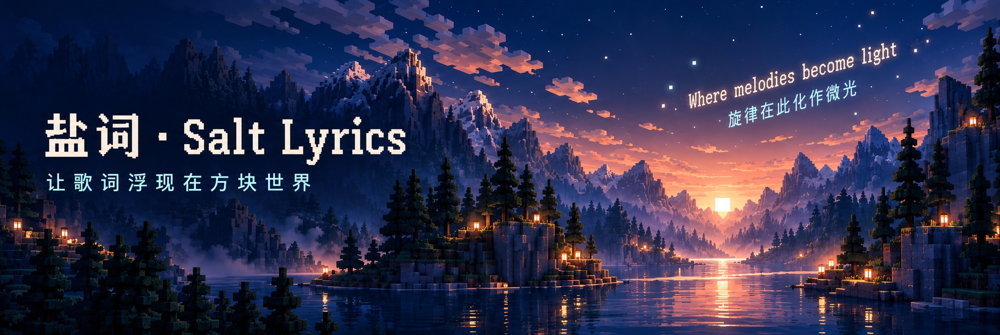

# Salt Lyrics



3D floating lyrics for the song playing in Salt Player, inside Minecraft.

English | [简体中文](README.md)

This independent mod derives its lyric rendering from DangoMusic by Sorihiko and contributors, under GPL-3.0. See [THIRD_PARTY_NOTICES.md](THIRD_PARTY_NOTICES.md) for the exact revision, source paths and modifications. This is a local development build; in-game visuals still need verification.

## Features

| Feature | Description |
| --- | --- |
| World lyrics | Floating text, line fades, character reveals and word pop |
| Animation | Adjustable wiggle and multi-level glow |
| Placement | Scale, distance, spread, camera facing and view-following options |
| Synchronization | Background SaltBridge polling, playback clock, lyric updates and timing offset |
| Bilingual lyrics | Original above translation; supports the translation field and parallel rows sharing a timestamp |
| Settings | Connection, transport controls and appearance inside Minecraft Options |

No ordinary screen lyric overlay, separate player panel, music search or account login. Audio is played by Salt Player. Servers do not need the mod.

## Install

Requires Minecraft **1.20.1**, Fabric Loader **0.16.10+**, the matching Fabric API and Java **17+**. Salt Player for Windows and [SaltBridge](https://github.com/Luoning77/saltbridge) must run on the same Windows computer.

1. Put the `-fabric.jar` from `build/libs/` in your instance's `mods` directory, alongside Fabric API. Fabric Language Kotlin is not required; Kotlin is bundled.
2. Enable SaltBridge in Salt Player and play a song with lyrics.
3. Open **Options → Salt Lyrics Settings** (top right). Automatic pairing is used by default; otherwise copy the access token and use **Paste token**.
4. Enter a world and adjust placement and appearance in Settings.

With the optional Mod Menu installed, select Salt Lyrics in the mod list and click its configuration button to open the same settings screen. The Options entry remains available without Mod Menu.

The lyric toggle key is unbound by default and can be assigned in Controls. F1 also hides lyrics. Apply port changes with **Apply and reconnect**. The position slider submits a seek when released. Appearance changes preview immediately and are saved with **Done**. A positive timing offset selects a later lyric position.

## Configuration

| Path | Purpose |
| --- | --- |
| `config/saltlyrics/settings.json` | Appearance, timing and port |
| `config/saltlyrics/salt_token.txt` | Manual token; only its last four characters are displayed |
| `~/.saltbridge/token.txt` | Automatic pairing when no manual token is configured |
| `version.properties` | Single project version source; local builds never increment it |

Real word timing is used when supplied by the player. For line-only lyrics, word-pop and line-splitting times are estimated animation. No external lyric search is performed.

Bilingual text follows the player-provided order. Original lyrics retain their word animation; translations fade in as complete lines. Paired cues stay together instead of splitting each language independently, and long text wraps visually. No translation is generated when the player supplies none.

Placement → Show translations is enabled by default. Turn it off to display only the original, then click Done to save.

## Build

Use JDK 21 to run Gradle; the output targets Java 17. Chinese Maven mirrors are preferred, with official repositories for Fabric and Architectury artifacts.

```bash
./gradlew test build sourceArchive
```

JARs are in `build/libs/`, and the complete source project ZIP is in `build/distributions/`. See [docs/VALIDATION.md](docs/VALIDATION.md) for validation and outstanding in-game checks. Iris/Sodium, shaders and other UI mods are unverified. This version uses Minecraft's pixel font; DangoMusic's smooth-font system has not been migrated.

## License and credits

**GPL-3.0-only**, see [LICENSE](LICENSE). Provide corresponding source and build materials when distributing binaries.

Thanks to [DangoMusic](https://github.com/Sorihiko/DangoMusic) for the original lyric rendering and animations. Maintained independently by Luoning77; this is not an official DangoMusic release.
